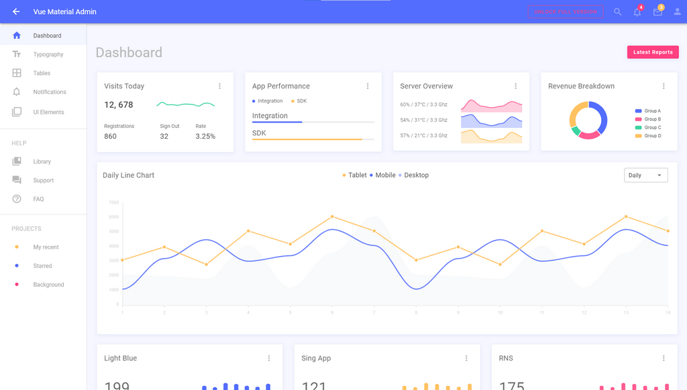

# 🤘 Vue Material Admin 

Free and open-source template built with Vue and Vuetify. Developed with ❤️ by Flatlogic, exemplifies a modern approach to UI design for [business software](https://flatlogic.com/). This template provides developers with a robust foundation for creating responsive and visually appealing administrative interfaces, encouraging support through engagement with their repository.  If you love our project please star ⭐️ our repo!

[View Demo](https://flatlogic.github.io/material-vue/) | [Download](https://github.com/flatlogic/material-vue.git) | [More templates](https://flatlogic.com/templates) | [Support forum](https://flatlogic.com/forum)

[](https://flatlogic.github.io/material-vue/)

## Features

Vue Material Admin is a great template to quick-start development of SAAS, CMS, IoT Dashboard, E-Commerce apps, etc  
Lite version of a Vue Material Admin includes following features and pages:

* Vuetify
* Responsive layout
* Vue Apex Charts
* Simple login / logout 
* Error page
* Styled Vuetify components like buttons, modals, etc

## Pages
We have implemented some basic pages, so you can see our template in action.

* Dashboard sample
* Typography
* Tables
* Notifications
* Charts
* Icons
* Maps
* Chat
* Login
* Error page

## Instalation 

1. Clone repository
```shell
git clone https://github.com/flatlogic/material-vue.git
```
2. Get in the project folder
```shell
cd material-vue
```
3. Install the locked dependencies with npm
```shell
npm ci
```

## Quick start
Run development server
```shell
npm run serve
```

## Support
For any additional information please go to our [**support forum**](https://flatlogic.com/forum) and raise your questions or feedback provide there. We highly appreciate your participation!

## How can I support developers?
- Star our GitHub repo :star:
- [Tweet about it](https://twitter.com/intent/tweet?text=Amazing%20dashboard%20built%20with%20%23VueJS%20and%20%23Bootstrap!&url=https://github.com/flatlogic/light-blue-vue-admin&via=flatlogic).
- Create pull requests, submit bugs, suggest new features or documentation updates :wrench:
- Follow [@flatlogic on Twitter](https://twitter.com/flatlogic).
- Subscribe to Flatlogic newsletter at [flatlogic.com](https://flatlogic.com/)
- Like our page on [Facebook](https://www.facebook.com/flatlogic/) :thumbsup:

## More from Flatlogic
- [Awesome Bootstrap Checkboxes & Radios](https://github.com/flatlogic/awesome-bootstrap-checkbox) - ✅ Pure css way to make inputs look prettier
- [React Native Starter](https://github.com/flatlogic/react-native-starter) - 🚀 A powerful react native starter template that bootstraps development of your mobile application
- [React Dashboard](https://github.com/flatlogic/react-dashboard) - 🔥 React Dashboard - isomorphic admin dashboard template with GraphQL
- [Sing App](https://github.com/flatlogic/sing-app) - 💥 Free and open-source admin dashboard template built with Bootstrap 4
- [Light Blue Dashboard](https://github.com/flatlogic/light-blue-dashboard) - 💦 Free and open-source (no frameworks) admin dashboard template built with Bootstrap

## Premium themes
Looking for premium themes and templates? Check out our other template at [flatlogic.com](https://flatlogic.com/admin-dashboards).

## License

Flatlogic One React Template version is [MIT](https://github.com/flatlogic/one-react-template/blob/master/LICENCE)-licensed.

* that's a joke actually, but we would really appreciate if you support us by buying a premium version. Anyways free is just free and is limited to only few components, while premium one has more and comes with premium support.

## Dependency maintenance (2026-11-05)

The supported stack is Vue 3, Vuetify 3, Vue Router 4, Vuex 4 and Vite. Use Node 22.12+ (verified with Node 22.23.0 and npm 10.9.8), a local Chrome installation, and the committed `package-lock.json` for reproducible installs. The old unlocked install failed an ApexCharts peer dependency check. The refreshed full npm graph, including development tools, reports 0 vulnerabilities without peer bypasses or dependency overrides.

```sh
npm ci
npm run lint
npm run build
npm test
```

The browser regression uses local Chrome against the production build. It covers both login tabs, dashboard charts, sidebar collapse and navigation, employee search/sorting/selection, notification placement, both icon sets and logout, plus a 390px mobile login/drawer/overflow check, and checks the configured brand color and card typography. All four revenue legend labels must fit inside the chart and select/deselect their pie slices. It also checks browser console messages, uncaught errors, and missing local assets.

Existing pages, sample data, Options API components, theme values and demo login behavior remain in place. Vue 3 changes require updated Vuetify slots/props, table headers, tab windows and SCSS selectors. Vue 3 ApexCharts replaces the Vue 2 wrapper; the native Vuetify sparkline preserves the existing trend widget. Notification controls use Vue Toastification's current API. Google Maps uses the supported Vue 3 component with the existing configuration; live provider access is not part of the local regression. Roboto and Material Design icons are bundled locally rather than fetched from external font CDNs.

`npm run build` regenerates the tracked `dist/` artifact for the existing hosting workflow. The obsolete Vue 2 hashed bundles and source maps are removed by the clean Vite build; commit the refreshed output with source changes. Production retains the `/material-vue/` public path. No deployment is performed by the verification commands. Sass deprecation and large-bundle warnings remain visible during the build.

Migration references: [Vue 3](https://v3-migration.vuejs.org/breaking-changes/), [Vuetify upgrade guide](https://vuetifyjs.com/en/getting-started/upgrade-guide/), [Vue Router migration](https://router.vuejs.org/guide/migration/), [Vite build](https://vite.dev/guide/build).
